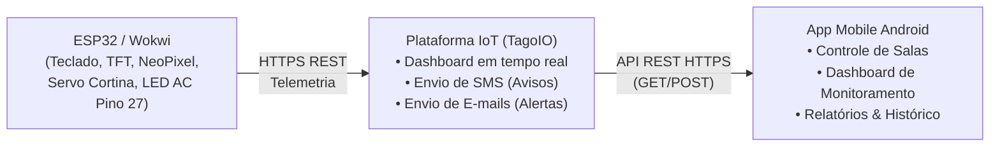

# Projeto de IoT e Sistemas Embarcados: Sala Automatizada
## Equipe:
- Anna Clara B Lima
- Luisa de Andrade Deschamps
- Raissa S. A. S. Almeida
  
Sistema completo de controle de acesso, automação de ambiente e monitoramento IoT integrado entre **Microcontrolador ESP32 (Arduino / Wokwi)**, **Plataforma IoT na Nuvem (TagoIO)** e **Aplicativo Mobile (Android / Jetpack Compose)**.

---

## 🔗 Links Oficiais do Projeto Online

- 🌐 **Simulador Wokwi (ESP32):** [Proj Sistemas Embarcados 2.0 - Wokwi](https://wokwi.com/projects/480979869852553217)
- 📊 **Dashboard na Nuvem (TagoIO):** [Painel de Monitoramento TagoIO](https://admin.us-e1.tago.io/dashboards?page=1&amount=20)

---

## 🏗️ Arquitetura da Solução

---

## 1. ☁️ Plataforma IoT na Nuvem (Requisitos Atendidos)

Para este projeto, a nuvem recomendada é a **TagoIO** (gratuita para uso educacional, sem necessidade de cartão de crédito e com SMS / E-mail nativos).

### Requisitos Atendidos na Nuvem:
- **a. Dashboard:** Painel visual com widgets para:
  - Presença na sala (Ocupada / Livre) e usuário autenticado;
  - Status do Ar Condicionado (Ligado / Desligado);
  - Medidor de Temperatura da sala (°C);
  - Estado da Cortina (Aberta / Fechada) e cor da Iluminação;
  - Gráfico de histórico de temperatura e eventos.
- **b. Envio de SMS:** Ação automática (*Action*) disparada por eventos críticos (ex: 3 tentativas de senha incorreta ou temperatura elevada).
- **c. Envio de E-mails:** Ação automática (*Action*) enviando e-mail formatado com avisos de acesso não autorizado e relatórios de uso.

### Passo a Passo de Configuração no TagoIO:
1. Acesse [https://admin.tago.io](https://admin.tago.io) e crie uma conta gratuita.
2. Em **Devices**, clique em **Add Device**:
   - Selecione **Custom HTTPS / REST** (ou **Generic Device**);
   - Dê o nome: `Sala Automatizada`;
   - Ao criar, copie o **Device Token** gerado.
3. **Configurar o Dashboard:**
   - Em **Dashboards**, crie um novo Dashboard Normal.
   - Adicione os Widgets:
     - **Card / Display:** para a variável `presenca` e `usuario`;
     - **Indicator / Switch:** para a variável `ar_condicionado`;
     - **Radial Gauge / Thermometer:** para a variável `temperatura` (escala 16 a 35 °C);
     - **Card:** para a variável `cortina` e `alerta`;
     - **Line Chart:** histórico da variável `temperatura`.
4. **Configurar Envio de E-mail (Requisito 1c):**
   - Vá em **Actions** > **Add Action**;
   - Nome: `Alerta Invasao Email`;
   - Trigger Type: `By Variable`;
   - Device: Selecione `Sala Automatizada` | Variable: `alerta` | Condition: `Equal to` -> `Tentativa de Invasao: 3 Senhas Incorretas` (ou `erros_senha >= 3`);
   - Action: `Send Email`;
   - Destinatário: Insira seu e-mail ou do professor;
   - Mensagem: *"ALERTA DE SEGURANÇA: Múltiplas tentativas de acesso inválidas foram detectadas na Sala Automatizada!"*.
5. **Configurar Envio de SMS (Requisito 1b):**
   - Em **Actions** > **Add Action**;
   - Nome: `Alerta Invasao SMS`;
   - Trigger Type: `By Variable` (`alerta` ou `erros_senha >= 3`);
   - Action: `Send SMS`;
   - Número de Telefone: Digite o número com código do país (ex: `+5511999999999`);
   - Mensagem: *"Alerta Sala: Tentativa de acesso nao autorizada detectada!"*.

---

## 2. 📱 Aplicativo Mobile (Requisitos Atendidos)

Desenvolvido em **Android nativo (Kotlin + Jetpack Compose + Material 3 + Room Database)** localizado na pasta `SalaAutomatizada/`.

### Requisitos Atendidos no App Mobile:
- **a. App de Monitoramento Mobile:**
  - **Aba "Salas":** Gerenciamento e personalização de salas, com botão inferior liga/desliga integrado à nuvem e bloqueio inteligente por presença;
  - **Aba "Monitoramento" (Dashboard Mobile):**
    - Status de conexão com a nuvem TagoIO em tempo real;
    - Card do Ar Condicionado com indicador de status (LED azul aceso no ESP32) e medidor de temperatura em °C;
    - Card de Ocupação da sala indicando o usuário presente;
    - Card de Iluminação e Cortina;
    - Banner de Alertas e Notificações (SMS / E-mail).
  - **Aba "Relatórios":**
    - Cards com resumo estatístico (Total de acessos, ciclos de ar condicionado ativo, temperatura média);
    - Linha do tempo completa de eventos (com carimbo de data/hora, tipo de evento, usuário e descrição);
    - **Botão Exportar Relatório:** Compartilha o relatório formatado em texto para WhatsApp, E-mail, Google Drive ou Bloco de Notas via Android Share Intent;
    - Opção para limpar histórico.

---

## 3. ⚡ Microcontrolador ESP32 (Sistemas Embarcados)

O programa do ESP32 está em `sala_de_aula/sala_de_aula.ino` e pronto para simulação no **Wokwi** (`sala_de_aula/diagram.json`).

### Componentes e Conexões:

| Componente | Função | Pino GPIO do ESP32 |
| :--- | :--- | :--- |
| **LED Ar Condicionado** | **Indicador de Ar Condicionado (NOVO)** | **GPIO 27** |
| Fita NeoPixel (8 LEDs) | Iluminação personalizada do usuário | GPIO 15 |
| Servo Motor | Abertura/fechamento da cortina | GPIO 13 |
| Display TFT ILI9341 | Tela de status e mensagens (CS / DC / RST) | GPIO 14, 21, 22 |
| Display TFT SPI | Barramento SPI (MOSI / SCK / MISO) | GPIO 23, 18, 19 |
| Teclado Matricial 4x4 | Linhas R1 a R4 | GPIO 19, 18, 5, 17 |
| Teclado Matricial 4x4 | Colunas C1 a C4 | GPIO 16 (RX2), 4, 25, 2 |

### Funcionamento do Ar Condicionado e Alertas:
- **Ao autenticar com sucesso:** O ar condicionado é **LIGADO** (LED azul no pino 27 acende), a cortina abre para 90°, os LEDs NeoPixel acendem na cor do usuário, a tela mostra as boas-vindas e a temperatura vai para 22°C. Uma mensagem HTTP POST é enviada à TagoIO.
- **Ao digitar senha incorreta:** O display mostra erro. Caso ocorram 3 erros consecutivos, um pacote com `alerta = "Tentativa de Invasao: 3 Senhas Incorretas"` é disparado para a nuvem TagoIO, ativando imediatamente as **Actions de SMS e E-mail**.
- **Ao deslogar com `*`:** O ar condicionado é **DESLIGADO** (LED azul no pino 27 apaga), a cortina fecha para 0°, a fita de LEDs apaga, a temperatura volta para ambiente (27°C) e a nuvem é notificada da desocupação da sala.

---

## 🚀 Como Executar o Projeto Completo

### 1. No Wokwi (Simulação do ESP32):
1. Abra o arquivo `sala_de_aula/sala_de_aula.ino`.
2. No código, insira o seu **Device Token** da TagoIO na variável `TAGO_DEVICE_TOKEN`.
3. Inicie a simulação. O ESP32 conectará na rede virtual `Wokwi-GUEST` e enviará a telemetria diretamente para a internet!
4. Digite senhas válidas (`1234`, `A1B2`, `9876`, `C0D3`) seguidas de `#`: veja o LED azul do Ar Condicionado acender, cortina abrir e dados subirem para o TagoIO.
5. Digite senhas erradas 3 vezes para testar o envio de alerta de SMS e e-mail.

### 2. No Aplicativo Android (Android Studio):
1. Abra a pasta `SalaAutomatizada` no Android Studio.
2. Execute em um emulador ou celular físico.
3. Crie uma conta ou faça login.
4. Na aba **Monitoramento**, toque no ícone de chave no canto superior e cole o mesmo **Device Token** da TagoIO.
5. Pronto! Os dados do ESP32 e da nuvem aparecem ao vivo na tela de **Monitoramento** e geram os relatórios na aba **Relatórios**.
